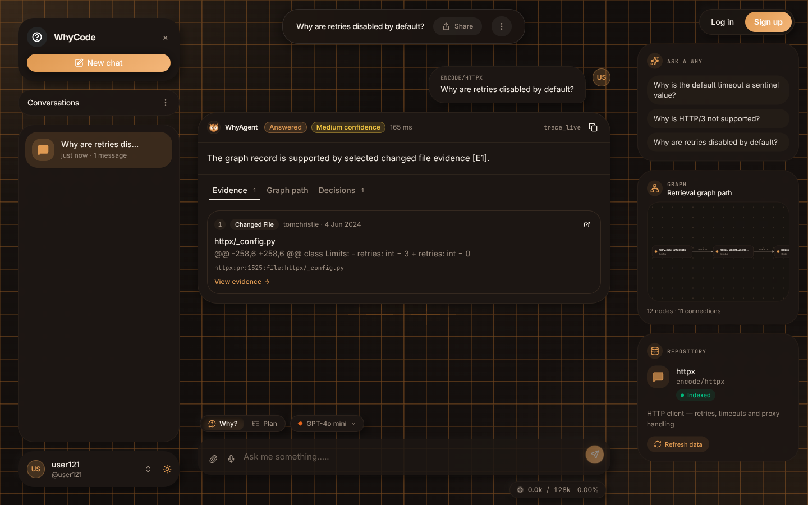
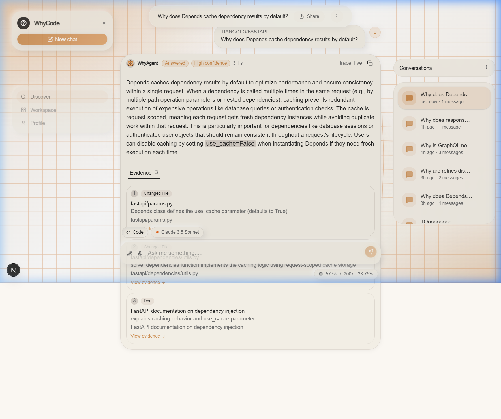
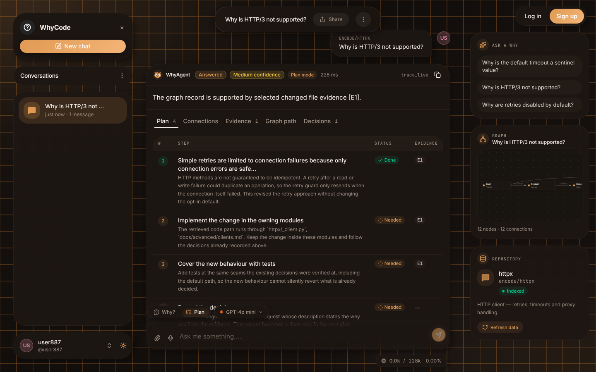
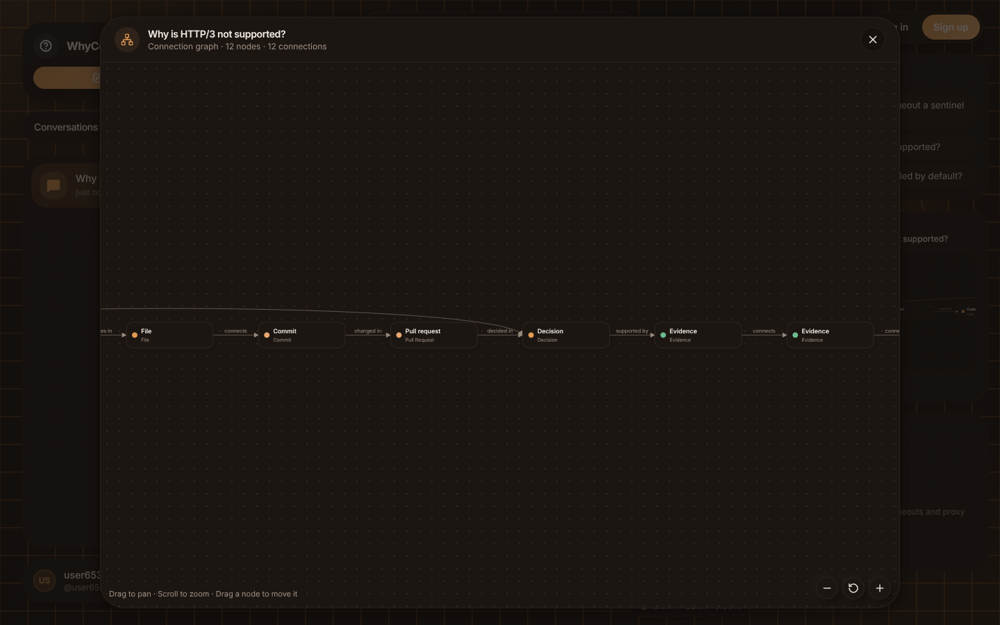
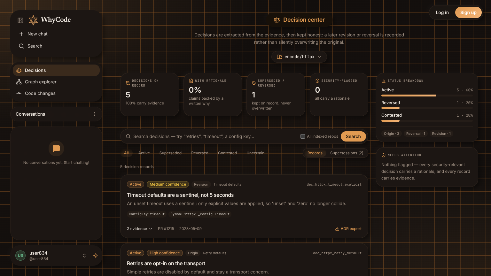
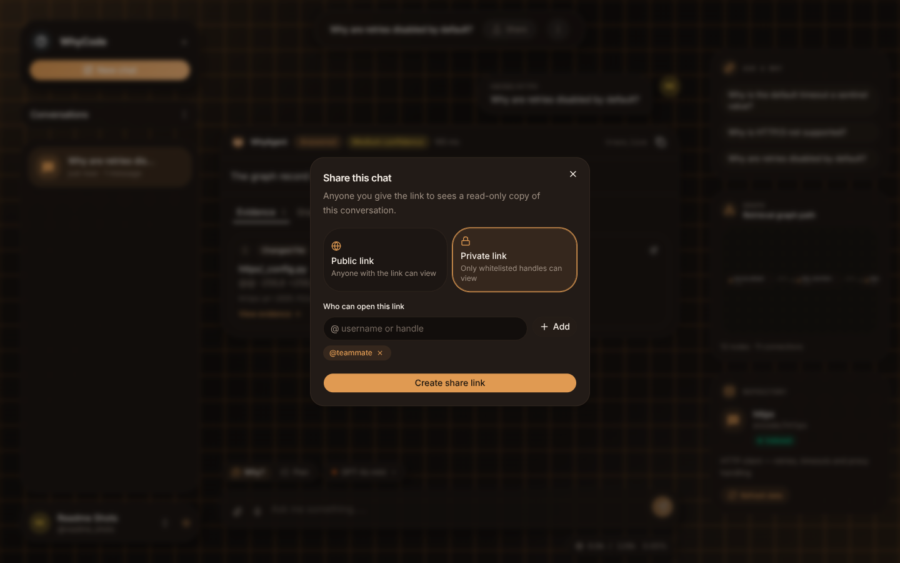
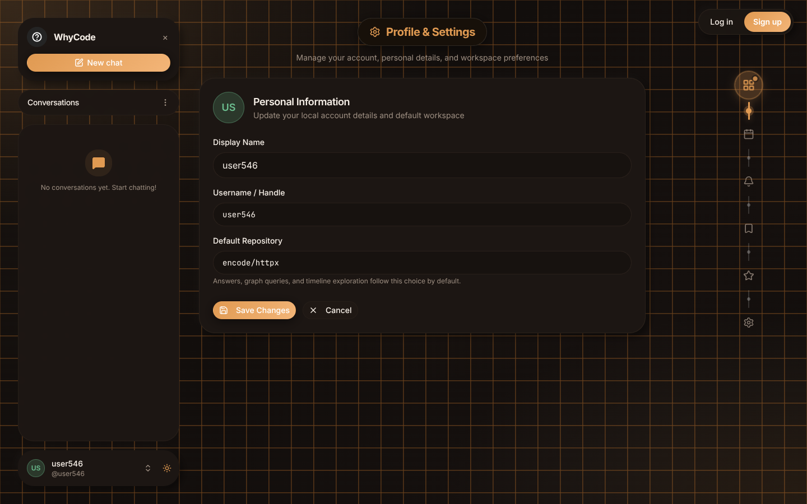
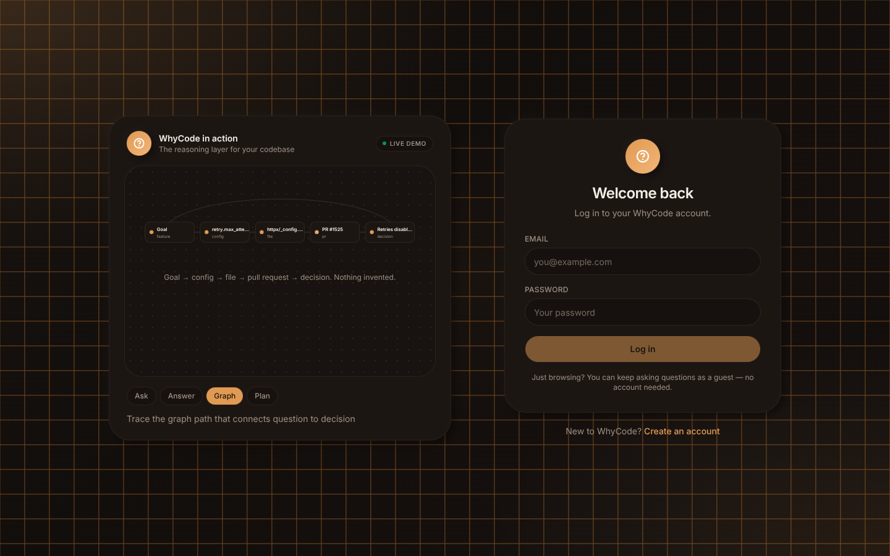
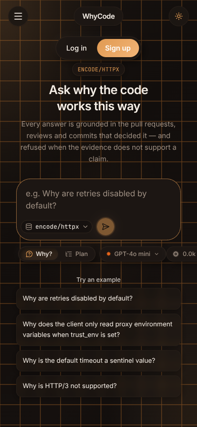

<div align="center">
  
</div>

<p align="center">
  <b>Ask why your code works the way it does — and see the evidence.</b><br/>
  <sub>Why-Code reads a repository's pull requests, reviews, commits and issues, extracts the engineering
  decisions hidden inside them into a Neo4j graph, and answers questions with citations to the real
  evidence — or refuses when the evidence isn't there.</sub>
</p>

<p align="center">
  <a href="https://why-code-ten.vercel.app"><b>Live app</b></a> ·
  <a href="https://why-code.onrender.com/health"><b>API health</b></a>
</p>

<p align="center">
  
  
  
  
  
  
</p>

Code tells you *what* it does. The *why* lives somewhere else — in a PR discussion from two years ago,
a review comment, a commit message nobody remembers writing. Why-Code mines that history once, turns it
into an evidence graph of files, symbols, config keys, people and decisions, and then answers questions
like *"Why are retries disabled by default?"* with the actual diff, the actual PR, and the actual
reasoning — each claim linked to the evidence that supports it. When the record doesn't support an
answer, it says so instead of guessing.

**Using it needs no setup and no keys:** open the app, pick (or paste) a public repository, and ask.
Every credential — GitHub, Neo4j, the LLM — lives on the server; visitors never provide one.

## Screenshots

The interface is a warm, floating-bubble design in dark and light themes, fully responsive down to phones.

### Ask — grounded answers with the evidence attached

| Dark | Light |
| :---: | :---: |
|  |  |

Every answer shows its status and confidence, the evidence it rests on (here: the diff that changed
`retries: int = 3` to `retries: int = 0`), the graph path behind it, and the decisions it touches.

### Plan mode — what's already done, what a change still needs



Plan mode turns the same retrieval into an implementation plan: steps the codebase has *already*
completed (with the decision and evidence that prove it) and the steps a change still *needs*, grounded
in the real modules and config the answer touched — never invented.

### Connection graph — question to decision, nothing invented



One graph engine renders every view: the answer's Connections tab, its Graph path tab, the rail
thumbnail, the fullscreen explorer (pan, zoom, drag nodes) and the `/graph` page. Edges are typed —
*changed in*, *decided in*, *supported by* — so the chain from a question to its evidence is auditable.
The explorer page pairs the canvas with a decision tracer that retells the traced path step by step,
one hop at a time.

### Decision center — every decision on record, kept honest



Extracted decisions are browsable, searchable and auditable. A later revision or reversal is recorded
as a supersession — the original is never silently overwritten. The page pairs the explorer with a
live audit rail — a status breakdown, the records that need attention, and recent webhook activity —
and the repository can be switched right on the page.

### Sharing and settings

| Share a chat — publicly, or only with whitelisted handles | Settings |
| :---: | :---: |
|  |  |

### Accounts and mobile

| Standalone login with a live product showcase | The full experience on a phone |
| :---: | :---: |
|  |  |

## Features

### Asking questions

- **Why? mode** — grounded answers synthesized only from retrieved evidence, with deduplicated
  citations, a confidence rating, and honest refusals (`insufficient_evidence` and friends) when the
  record can't support a claim.
- **Plan mode** — a step table (Done / Needed, each row tied to evidence) plus a connection graph,
  built deterministically from the answer's own retrieval.
- **Structure questions** — ask how a repository is laid out and get a directory/module tree graph
  built from the real evidence paths.
- **Evidence everywhere** — every answer carries its evidence cards (diffs, PR and commit links),
  the decisions it relies on, and the graph path that connects them.
- **Suggested questions** — a rotating set of "Ask a why" prompts per repository in the side rail,
  plus one-click example questions on the landing page.

### Models

- The composer shows the **server's active model** and a **live token meter**: real, provider-reported
  usage against that model's context window.
- **Bring your own model** — visitors can add any OpenAI-compatible model (name, model id, endpoint,
  API key) and ask through it. Keys are Fernet-encrypted at rest, scoped to the visitor's browser,
  and never shown again after saving.

### Composer

- **File attachments** — attach files from the paperclip menu (or `Ctrl+U`); text files are read in
  the browser and inlined into the question, and show as chips on your message.
- **Screenshots** — "Take a screenshot" captures one frame of your screen straight into the chat.
- **Voice input** — dictate with the Web Speech API; transcription appends to your draft as you speak.
- The composer grows as you type and resets when you send.

### Conversations

- The sidebar collapses to an icon rail from its panel control, and its search **tolerates typos** —
  one or two wrong letters still find the chat, across titles and answer text.
- Chats are saved locally in your browser: rename (the header keeps its size while you edit), export
  to Markdown, delete one or clear all.
- **Incognito mode** — while it's on, your saved history disappears from the panel entirely, anything
  you ask lives only in memory, is never written to storage or the URL, and is discarded the moment
  you exit incognito.
- **Haptics** — subtle vibration feedback on supported mobile browsers, with a Settings toggle
  (on by default).

### Sharing

- **Public links** — anyone with the link sees a read-only copy of the conversation.
- **Private links** — only signed-in users whose @handle is on your whitelist can open it; everyone
  else gets a clear "not on the list" screen naming their own handle.
- Update a link in place as the chat grows, or stop sharing at any time. Sharing needs an account;
  incognito chats can't be shared.

### Accounts

- Sign up with email + password and a **6-digit email OTP** (10-minute, single-use codes; passwords
  are Argon2id-hashed, sessions are 7-day JWTs, auth endpoints are rate-limited).
- **Guests can do everything except share** — no account required to ask. Guests get a friendly
  `userNNN` identity; signing in replaces it with your real name and handle everywhere at once.

### Decision platform

- **Decision records API + explorer** — normalized records with search and filters for status, kind,
  target and date; an evidence drill-down on every record.
- **Cross-repo search** — search decisions across every indexed repository at once.
- **Supersessions dashboard** — claim-vs-claim pairs showing what replaced what, and why.
- **Audit & compliance report** — rationale/evidence coverage, plus the flags that matter:
  security- or incident-relevant decisions missing a rationale, and decisions with no evidence.
- **ADR export** — download any record as an Architecture Decision Record (Markdown) or JSON.
- **Explorer pages** — the decision center, the graph explorer and code changes are one click away in
  the sidebar. Each page carries its own repository switcher and a dedicated right rail: decision
  health (status breakdown, needs-attention flags, live updates), a step-by-step path tracer, and
  change activity (line volume, top contributors, most-touched files).
- **Code changes feed** — every change card shows the reasoning behind the change, who wrote,
  reviewed and took part, and a button that opens the carrying commit on GitHub. Line stats and
  touched files come from the real commit data; a commit that references a pull request links to
  that pull request, and one that landed directly is labelled "Direct commit" — nothing is
  synthesized to fill a gap.
- **Fresh data without setup** — the Repository card's **Refresh data** button re-derives a repo's
  decisions from current GitHub data (rate-limited per repo). Repository *owners* can additionally
  register a GitHub webhook for automatic refresh on merged PRs (HMAC-verified, deduplicated);
  end users never configure anything.
- **Decision tooling for repos** — a policy-as-code gate (incidents need a postmortem, reversals need
  evidence), a PR comment assistant that drafts decision records, and a golden-set regression runner.
  See [`docs/FEATURES.md`](docs/FEATURES.md).

### The pipeline underneath

- **Ingestion** of merged PRs with their reviews, commits and issues, normalized and relevance-scored.
- **Graph building** into Neo4j: files, symbols, code regions, config keys, people, commits, PRs.
- **Structural enrichment** with tree-sitter (Python-first) plus YAML/TOML/env config keys.
- **Decision extraction** — an LLM proposes candidate decisions; deterministic gates validate every
  citation, compute confidence, detect supersession and dedupe before anything is written.
- **Hybrid retrieval** — exact + full-text + vector search with graph expansion, fused (WRRF),
  reranked and packed into evidence the synthesizer may cite from — and nothing else.
- **Multi-language candidate detection** — high-value path packs for Python, Go, Java, Rust and
  TypeScript.

## How it works

```mermaid
flowchart LR
  GH["GitHub<br/>PRs · reviews · commits · issues"] --> ING["Ingestion<br/>normalize + score"]
  ING --> GRAPH["Graph builder<br/>files · symbols · regions · people"]
  GRAPH --> STRUCT["Structural enricher<br/>tree-sitter + config keys"]
  STRUCT --> DEC["Decision extractor<br/>LLM proposes · gates validate"]
  DEC --> NEO[("Neo4j<br/>evidence graph")]
  NEO --> RET["Retrieval<br/>exact + full-text + vector + graph expansion"]
  RET --> SYN["Synthesis<br/>constrained · citation-checked"]
  SYN --> API["FastAPI<br/>/api/v1"]
  API --> UI["Next.js UI<br/>ask · plan · decisions · share"]
```



**An ask, step by step:**

1. The UI sends the question, the repository and the mode (`why` or `plan`) to `POST /api/v1/ask`.
2. The retrieval pipeline runs its fixed branches over the Neo4j graph, fuses and reranks the results,
   and packs an evidence set.
3. The model writes an answer constrained to that evidence; deterministic code then validates every
   citation and quote against the evidence store before the answer is allowed out.
4. If validation fails or the evidence is thin, the service refuses with a reason instead of
   improvising. In Plan mode, the validated answer's own retrieval is turned into the step table and
   connection graph — no second, ungrounded generation pass.

**The trust model:** the LLM is a proposer, never the authority. Citations, confidence, supersession
and the final graph writes are all computed by deterministic code, and every claim in the UI can be
traced back to a PR, a diff or a commit.

Alongside the answer service, the backend runs three product services on the same FastAPI app:
**auth** (accounts, OTP, sessions), **shares** (public/private chat links) and **features** (decision
records, search, audit, webhooks). Each stores to Neo4j when configured and degrades to a local
SQLite file otherwise, so a fresh clone always boots.

## Quick start

### One-command launchers

**Demo mode** — offline fixture data, no Neo4j and no API keys:

- Windows (Command Prompt / double-click): `startdemo.bat`
- Windows (PowerShell): `.\startdemo.ps1`
- macOS / Linux: `./startdemo.sh`

Starts the backend on `http://localhost:8000` and the frontend on `http://localhost:3000`.

**Production mode** — live Neo4j + LLM. Fill in `backend/.env` first (see
[Configuration](#configuration)), then:

- Windows: `startprod.bat` / `.\startprod.ps1`
- macOS / Linux: `./startprod.sh`

### Manual setup

Prerequisites: Python 3.12+, Node.js 20+. Production mode additionally needs a Neo4j instance
(AuraDB or local), an OpenAI-compatible API key, and a GitHub token for ingestion.

```bash
git clone https://github.com/himanshuksr0007/Why-Code.git
cd Why-Code/backend

python3 -m venv .venv
source .venv/bin/activate
pip install -e '.[dev]'

cp .env.example .env      # fill in the values
set -a; source .env; set +a   # .env is not auto-loaded
```

```bash
# Live app (needs the env above)
PYTHONPATH=. uvicorn app.main:create_app --factory --reload

# Offline demo app (fixtures only, no credentials)
PYTHONPATH=. uvicorn app.main:create_demo_app --factory --reload

curl http://localhost:8000/health
# {"service":"why-code","status":"ok","version":"0.0.1"}
```

`/health` is always live. Without a configured retrieval service, the ask routes return `503` by
design; the demo app answers from its fixture graph instead.

Frontend:

```bash
cd frontend
npm install
cp .env.example .env.local   # defaults run the UI against bundled mock fixtures
npm run dev                  # http://localhost:3000
```

To point the UI at the backend, set `NEXT_PUBLIC_API_MODE=http` and
`NEXT_PUBLIC_API_BASE_URL=http://localhost:8000` in `.env.local`.

### Run the pipeline

```bash
cd backend

# 1. Ingest merged PRs and normalize their history
PYTHONPATH=. python -m app.ingestion.cli ingest \
  --repo encode/httpx --since 2024-01-01 --limit 100 \
  --artifacts-dir ../artifacts

# 2. Enrich changed files with tree-sitter and load the graph
PYTHONPATH=. python -m app.structural.cli build \
  --repo encode/httpx \
  --normalized ../artifacts/normalized.jsonl \
  --high-signal ../artifacts/high_signal_prs.jsonl \
  --artifacts-dir ../artifacts --remote --write

# 3. Extract evidence-linked decisions (dry run; add --write to load Neo4j)
PYTHONPATH=. python -m app.intent.cli extract \
  --repo encode/httpx \
  --normalized ../artifacts/normalized.jsonl \
  --high-signal ../artifacts/high_signal_prs.jsonl \
  --structural-graph ../artifacts/structural/structural_graph.jsonl \
  --db ../artifacts/evidence.db \
  --artifacts-dir ../artifacts
```

Generated artifacts land in `artifacts/` and are git-ignored.

### Verify

```bash
cd backend
PYTHONPATH=. python -m pytest --ignore=tests/structure
ruff check app tests
mypy app
```

Current backend result: **1,109 passed**, 13 pre-existing failures in the live-mode contract tests,
12 skipped (opt-in live Neo4j / live LLM tests). `tests/structure/` is a legacy parallel contract
suite that conflicts with `tests/structural/` at collection time; the canonical suite excludes it.

```bash
cd frontend
npm run build && npm run typecheck && npm run lint
```

## Configuration

### Backend (`backend/.env`)

| Variable | Required | Purpose |
| --- | :---: | --- |
| `WHYCODE_GITHUB_TOKEN` | ingestion | GitHub API token for repository ingestion |
| `WHYCODE_NEO4J_URI` / `_USER` / `_PASSWORD` | production | Neo4j (AuraDB or local) connection |
| `WHYCODE_NEO4J_DATABASE` | — | Target database (default `neo4j`) |
| `WHYCODE_LLM_API_KEY` | production | OpenAI-compatible key (any compatible endpoint works) |
| `WHYCODE_LLM_MODEL` | — | Server model shown in the composer (default `gpt-4o-mini`) |
| `WHYCODE_LLM_BASE_URL` | — | Compatible endpoint (default `https://api.openai.com/v1`) |
| `WHYCODE_LLM_CONTEXT_TOKENS` | — | Context window used by the UI token meter |
| `WHYCODE_SECRET_KEY` | production | Fernet key encrypting visitors' custom-model API keys at rest. Without it an ephemeral key is used and saved keys die on restart |
| `WHYCODE_AUTH_SECRET` | production | Signs session tokens and OTP digests. Required, or sessions/pending OTPs die on restart |
| `WHYCODE_GMAIL_ADDRESS` | auth mail | Sender address for verification emails (also the default Brevo sender) |
| `WHYCODE_BREVO_API_KEY` | recommended | Sends OTP mail over Brevo's HTTPS API. **Use this on hosts that block outbound SMTP (e.g. Render)** — it takes precedence over Gmail SMTP. Disable Brevo's IP authorisation: host egress IPs rotate |
| `WHYCODE_GMAIL_APP_PASSWORD` | SMTP fallback | Gmail app password, used only when no Brevo key is set. With neither set, codes go to a console outbox file (development) |
| `WHYCODE_MAIL_FROM` | — | Override the sender address |
| `WHYCODE_AUTH_DB` | — | SQLite fallback path for accounts (default `artifacts/auth.db`) |
| `WHYCODE_SHARE_DB` | — | SQLite fallback path for share links (defaults to the auth DB) |
| `WHYCODE_WEBHOOK_SECRET` | webhooks | GitHub webhook secret; the receiver returns 503 until it is set |
| `WHYCODE_WEBHOOK_DB` | — | Webhook delivery store (default `artifacts/webhooks.db`) |
| `WHYCODE_ARTIFACTS_DIR` | — | Pipeline output directory (default `artifacts`) |

### Frontend (`frontend/.env.local`)

| Variable | Purpose |
| --- | --- |
| `NEXT_PUBLIC_API_MODE` | `http` for the live backend, `mock` for bundled fixtures (default) |
| `NEXT_PUBLIC_API_BASE_URL` | Backend base URL when in `http` mode |
| `NEXT_PUBLIC_REPO` | Repository the UI asks about by default (e.g. `encode/httpx`) |

## Deployment

The production deployment is split:

- **Frontend — Vercel.** Root directory `frontend`, with `NEXT_PUBLIC_API_MODE=http` and
  `NEXT_PUBLIC_API_BASE_URL` pointing at the backend. Deploys automatically on push to `main`.
- **Backend — Render.** Runs the FastAPI app with the production env above; point the health check
  at `/health`. Two operational notes from running it: Render blocks outbound SMTP, so verification
  mail must go through Brevo (`WHYCODE_BREVO_API_KEY`); and `WHYCODE_SECRET_KEY` +
  `WHYCODE_AUTH_SECRET` must be set, or custom-model keys and sessions reset on every redeploy.

Any equivalent split (static/Node host + a Python host) works the same way.

## Project layout

```text
.
├── backend/
│   ├── app/
│   │   ├── core/          # settings, errors, logging
│   │   ├── domain/        # evidence records + stable IDs
│   │   ├── ingestion/     # GitHub ingestion → normalized history
│   │   ├── graph/         # Neo4j graph builder
│   │   ├── structural/    # tree-sitter enrichment
│   │   ├── intent/        # decision extraction (LLM + gates)
│   │   ├── retrieval/     # hybrid retrieval, synthesis, plan + structure builders
│   │   ├── models/        # visitor custom models + token usage
│   │   ├── auth/          # accounts, email OTP, sessions
│   │   ├── shares/        # public/private chat share links
│   │   ├── features/      # decision records, search, audit, webhooks
│   │   └── main.py        # FastAPI factories (live + demo)
│   ├── tools/             # policy gate, PR decision assistant, golden runner
│   └── tests/             # contract tests, grouped by area
├── frontend/              # Next.js 16 app (chat, decisions, graph, settings, auth, share viewer)
├── docs/                  # product decisions, feature guide, reports
├── assets/readme/         # banner + screenshots
└── README.md
```

## Documentation

| Topic | Document |
| --- | --- |
| Backend guide | [`backend/README.md`](backend/README.md) |
| Decision platform features | [`docs/FEATURES.md`](docs/FEATURES.md) |
| Ingestion | [`backend/app/ingestion/README.md`](backend/app/ingestion/README.md) |
| Graph builder | [`backend/app/graph/README.md`](backend/app/graph/README.md) |
| Structural enricher | [`backend/app/structural/README.md`](backend/app/structural/README.md) |
| Decision extractor | [`backend/app/intent/README.md`](backend/app/intent/README.md) |
| Retrieval | [`backend/app/retrieval/README.md`](backend/app/retrieval/README.md) |
| Product decisions | [`docs/DECISIONS.md`](docs/DECISIONS.md) |
| Golden decision set | [`docs/GOLDEN_SET.md`](docs/GOLDEN_SET.md) |

## Known limitations

- Attached **images and screenshots are conversation artifacts**: they render in the chat, but the
  answering pipeline is text-only today, so the model reads inlined *text* files, not image content.
- Structural enrichment parses **Python**; other languages are covered by candidate detection and
  ingestion, not yet by the tree-sitter enricher.
- Demo mode answers from a small fixture graph for one repository — it demonstrates the full product
  surface, not live retrieval quality.

---

<p align="center">
  <sub>FastAPI · Pydantic · tree-sitter · Neo4j · Next.js 16 · Tailwind CSS v4</sub>
</p>
