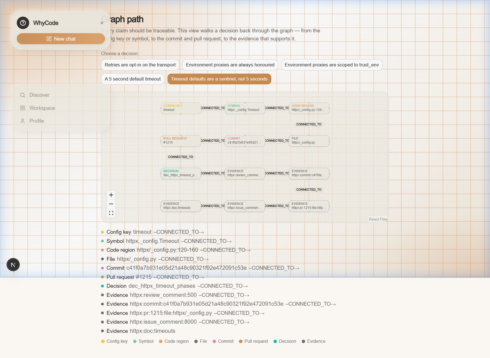
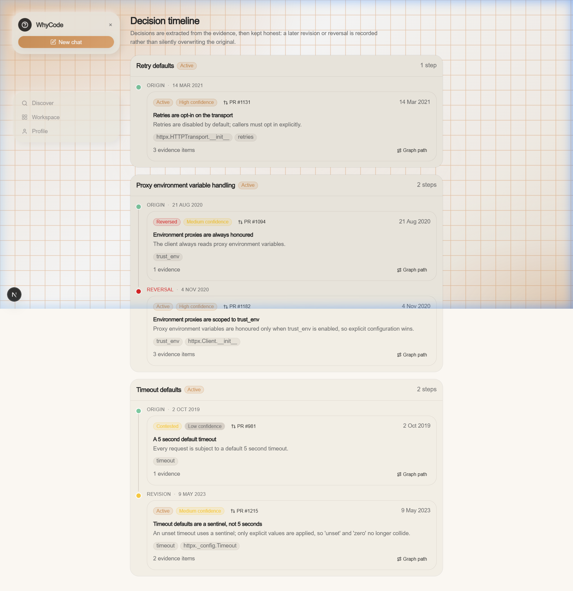
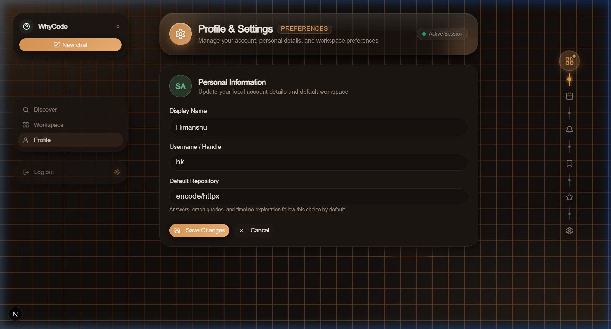
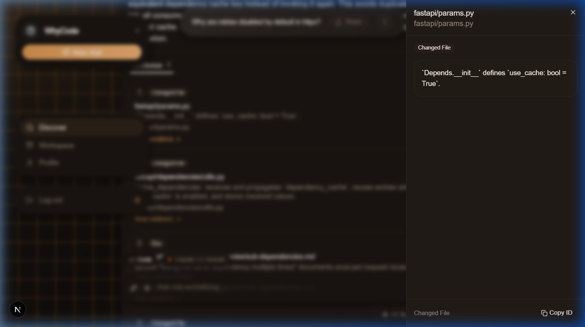

<div align="center">
  
</div>

<p align="center">
  <b>Ask why your code works the way it does — and see the evidence.</b><br/>
  <sub>GraphRAG over a repository's pull requests, reviews, commits and issues.</sub>
</p>

<p align="center">
  
  
  
  
  
  
</p>

**WhyCode** explains *why* a codebase works the way it does, using its own development history as evidence. It ingests merged pull requests and the conversation around them, builds a Neo4j graph of files, symbols, regions, people and decisions, and extracts evidence-linked engineering decisions. Every claim is traceable; when the evidence is insufficient, the system refuses instead of guessing.

> [!IMPORTANT]
> **Work in progress.** The backend pipeline through the GraphRAG answer service is implemented and tested, including the read-only Neo4j retrieval adapter. The production embedding model and the published UI are not built yet — see [Built vs. what's left](#built-vs-whats-left).

## Screenshots

WhyCode provides a rich, responsive interface with seamless **Dark Mode** and **Light Mode** support. Toggle modes instantly using the theme button or match your system preferences.

### Ask & GraphRAG Synthesis with WhyAgent

| Dark Mode (Obsidian & Orange Grid) | Light Mode (Warm Canvas & Orange Grid) |
| :---: | :---: |
|  |  |
| Synthesis with WhyAgent avatar, decision cards & categorical confidence | Crystal-clear typography, citations & structured evidence links |

### Interactive Graph Path Explorer

| Dark Mode Graph | Light Mode Graph |
| :---: | :---: |
|  |  |
| Visual path from ConfigKey → Symbol → Region → Commit → PR | 4-sided dynamic directional handles with inspectable nodes |

### Decision Timeline & History

| Decisions (Dark Mode) | Decisions (Light Mode) |
| :---: | :---: |
|  |  |
| Chronological decisions tracking origins, revisions and reversals | Complete timeline with confidence ratings and commit/PR links |

### Contributor Profile & Evidence Inspection

| Profile with Connected Vertical Nav | Evidence Sheet Inspector |
| :---: | :---: |
|  |  |
| Interactive vertical connected icon nav with hover labels | Slide-out evidence inspector with diffs, payloads & source links |

## How it works

<p align="center">
  
</p>
<p align="center"><sub><b>Built:</b> GitHub → ingestion/SQLite → graph → structure → decisions → retrieval/answer API → judge demo UI. <b>Next:</b> production embedding provider and live UI integration.</sub></p>

The LLM is a **proposer**, never the authority: deterministic code validates every citation against the evidence store and graph, computes confidence, detects supersession, and writes the graph.

## Quick start

### 🚀 One-Command Launchers

You can launch both the backend and frontend together with a single script:

#### 1. Demo Mode (Zero Configuration)
Runs the demo version using offline fixture data. **No Neo4j database or API keys required**:
- **Windows (Command Prompt / Double Click):** `startdemo.bat`
- **Windows (PowerShell):** `.\startdemo.ps1`
- **macOS / Linux:** `./startdemo.sh`

> Automatically starts the backend at `http://localhost:8000` and frontend at `http://localhost:3000`.

#### 2. Production Mode (Full GraphRAG + Live Neo4j)
Runs the production version with live Neo4j database and LLM decision extraction:
> [!IMPORTANT]
> **Production mode requires all keys to be set** in `backend/.env` before running:
> - `WHYCODE_NEO4J_URI`, `WHYCODE_NEO4J_USER`, `WHYCODE_NEO4J_PASSWORD`
> - `WHYCODE_LLM_API_KEY` (and optionally `WHYCODE_LLM_MODEL`, `WHYCODE_LLM_BASE_URL`)
> - `WHYCODE_GITHUB_TOKEN` (for repository ingestion)

Run the production launcher:
- **Windows (Command Prompt / Double Click):** `startprod.bat`
- **Windows (PowerShell):** `.\startprod.ps1`
- **macOS / Linux:** `./startprod.sh`

---

### Manual Setup

**Prerequisites:** Python 3.12+, Node.js 20+, a GitHub token, a Neo4j AuraDB (or local Neo4j) instance, and an OpenAI-compatible API key.

```bash
git clone https://github.com/himanshuksr0007/Why-Code.git
cd Why-Code/backend

python3 -m venv .venv
source .venv/bin/activate
pip install -e '.[dev]'

cp .env.example .env      # fill in the values
set -a; source .env; set +a
```

Settings are read from environment variables; `.env` is not auto-loaded, hence the `source` line.

### Run the API

```bash
PYTHONPATH=. uvicorn app.main:create_app --factory --reload
curl http://localhost:8000/health
# {"service":"why-code","status":"ok","version":"0.0.1"}
```

`/health` is always live. The answer API (`POST /ask`, also mounted at `/api/v1/ask`) is available when a retrieval service is injected; without one those routes return `503`.

### Run the prepared judge demo

The `/demo` flow uses the real retrieval pipeline against a deterministic
fixture graph, so it needs no Neo4j or model credentials. In one terminal:

```bash
cd backend
PYTHONPATH=. .venv/bin/uvicorn app.main:create_demo_app --factory --reload
curl -X POST http://localhost:8000/demo/rehearse \
  -H 'content-type: application/json' -d '{}'
```

In another:

```bash
cd frontend
npm install
npm run dev
# open http://localhost:3000/demo
```

The demo page calls the backend directly (default
`http://localhost:8000`; override with `NEXT_PUBLIC_API_BASE_URL`). It shows the
five-question script, then answer, citations, evidence cards, people, decision
timeline, supersession labels and the interactive graph path. The fifth
question asks about the logo and must refuse with `insufficient_evidence`.

> The measured latency is local fixture-pipeline latency, not a live Neo4j or
> model round trip. `/demo/rehearse` checks the script deterministically and
> reports the measured value against the 8,000 ms budget / 5,000 ms target.

### Run the pipeline

```bash
# 1. Ingest merged PRs and normalize their history
PYTHONPATH=. python -m app.ingestion.cli ingest \
  --repo encode/httpx --since 2024-01-01 --limit 100 \
  --artifacts-dir ../artifacts

# 2. Enrich changed files with tree-sitter and load the graph
PYTHONPATH=. python -m app.structural.cli build \
  --repo encode/httpx \
  --normalized ../artifacts/normalized.jsonl \
  --high-signal ../artifacts/high_signal_prs.jsonl \
  --artifacts-dir ../artifacts --remote --write

# 3. Extract evidence-linked decisions (dry run; add --write to load Neo4j)
PYTHONPATH=. python -m app.intent.cli extract \
  --repo encode/httpx \
  --normalized ../artifacts/normalized.jsonl \
  --high-signal ../artifacts/high_signal_prs.jsonl \
  --structural-graph ../artifacts/structural/structural_graph.jsonl \
  --db ../artifacts/evidence.db \
  --artifacts-dir ../artifacts
```

Generated artifacts land in `artifacts/` and are git-ignored.

### Verify the build

```bash
PYTHONPATH=. python -m pytest --ignore=tests/structure
ruff check app tests
mypy app
```

Current result: **1030 passed, 9 skipped**, ruff clean, mypy clean. Eight skips are opt-in live-Neo4j tests; the ninth is the opt-in live-LLM smoke test.

> `tests/structure/` is a legacy parallel contract suite that conflicts with `tests/structural/` at collection time. The canonical suite excludes it.

## Built vs. what's left

| Plan component | Status | What exists | What's missing |
| --- | :---: | --- | --- |
| **0 · Foundation** | ✅ | Typed settings, error taxonomy, structured logging, evidence records/IDs, `/health`, tests | CI workflow and Docker Compose were deliberately cut (D-0005) |
| **1 · GitHub ingestion** | ✅ | Merged-PR client, normalizer, SQLite store, relevance scoring, JSONL exports, ingestion report, CLI | Live 50–100 PR acceptance run is not reproduced in the repo (needs a token) |
| **2 · Neo4j graph builder** | ✅ | Graph mapping, commit-scoped regions, batched `MERGE` writer, constraints/indexes, integrity checks | Live AuraDB load is opt-in and was not executed here |
| **3 · Structural enricher** | ✅ | Tree-sitter Python symbols/imports/references, YAML/TOML/env config keys, docs, regions, validation | Python only; JS/TS/Rust and lock files are skipped by design |
| **4 · Decision extractor** | ✅ | Candidate detection, context packing, strict schemas, evidence/claim/rule gates, confidence, supersession, dedupe, review queue, Neo4j writer, hand-curated golden set + deterministic evaluation | Live LLM acceptance and the public golden-suite run are not demonstrated in this repo (public cases are curated but unexecuted) |
| **5 · GraphRAG retrieval** | ✅ | Fixed retrieval pipeline (exact + full-text + vector + graph expansion), static read-only Neo4j `GraphBackend`/`LookupBackend` adapter, WRRF fusion, reranking, evidence packing, constrained synthesis, citation/quote validation, four refusal modes, `/ask` and supporting API routes, deterministic Phase 10 judge demo, 321 retrieval contract tests | A production embedding model and the golden-question acceptance run are not included; live latency is not measured |
| **6 · Evidence UI** | ✅ | Full Next.js frontend with live GraphRAG ask/answer, interactive ReactFlow graph explorer, decision timeline, evidence sheet inspector, Dark/Light themes, WhyAgent integration, and connected vertical-line profile navigation | Production deployment |

**Also not done:** production embedding provider, retrieval golden-question acceptance run, Aura Agent/MCP integration, CI and Docker, live acceptance evidence for Components 1–5.

## Project layout

```text
.
├── backend/
│   ├── app/
│   │   ├── core/          # settings, errors, logging
│   │   ├── domain/        # evidence records + stable IDs
│   │   ├── ingestion/     # Component 1  → README
│   │   ├── graph/         # Component 2  → README
│   │   ├── structural/    # Component 3  → README
│   │   ├── intent/        # Component 4  → README
│   │   ├── retrieval/     # Component 5  → README
│   │   └── main.py        # FastAPI factory; /health + retrieval routes
│   ├── tests/             # contract tests, grouped by component
│   └── README.md          # backend guide
├── frontend/              # Next.js product prototype + /demo judge workspace
├── docs/                  # decisions and validation reports
├── assets/readme/         # banner + screenshots
├── artifacts/             # generated outputs (git-ignored)
└── README.md
```

## Component documentation

| Component | Documentation |
| --- | --- |
| Foundation | [`backend/README.md`](backend/README.md) |
| 1 · Ingestion | [`backend/app/ingestion/README.md`](backend/app/ingestion/README.md) |
| 2 · Graph builder | [`backend/app/graph/README.md`](backend/app/graph/README.md) |
| 3 · Structural enricher | [`backend/app/structural/README.md`](backend/app/structural/README.md) |
| 4 · Decision extractor | [`backend/app/intent/README.md`](backend/app/intent/README.md) |
| 5 · Retrieval | [`backend/app/retrieval/README.md`](backend/app/retrieval/README.md) |
| Product decisions | [`docs/DECISIONS.md`](docs/DECISIONS.md) |
| Golden decision set | [`docs/GOLDEN_SET.md`](docs/GOLDEN_SET.md) |
| Ingestion report | [`docs/INGESTION_REPORT.md`](docs/INGESTION_REPORT.md) |
| Validation report | [`docs/VALIDATION_REPORT_PHASE10.md`](docs/VALIDATION_REPORT_PHASE10.md) |

## Configuration

| Variable | Required | Default | Purpose |
| --- | :---: | --- | --- |
| `WHYCODE_GITHUB_TOKEN` | ✅ | — | GitHub API token for ingestion |
| `WHYCODE_NEO4J_URI` | ✅ | — | AuraDB/local Bolt URI |
| `WHYCODE_NEO4J_USER` | ✅ | — | Neo4j user |
| `WHYCODE_NEO4J_PASSWORD` | ✅ | — | Neo4j password |
| `WHYCODE_NEO4J_DATABASE` | — | `neo4j` | Target database |
| `WHYCODE_LLM_API_KEY` | ✅ | — | OpenAI-compatible key (Groq works as-is) |
| `WHYCODE_LLM_MODEL` | — | `gpt-4o-mini` | Extraction model |
| `WHYCODE_LLM_BASE_URL` | — | `https://api.openai.com/v1` | Compatible endpoint |
| `WHYCODE_LLM_TIMEOUT_SECONDS` | — | `60` | LLM request timeout |
| `WHYCODE_LLM_RPM` / `_RPD` | — | `30` / `1000` | Published request caps |
| `WHYCODE_LLM_TPM` / `_TPD` | — | `8000` / `200000` | Published token caps |
| `WHYCODE_LLM_BUDGET_REQUESTS` | — | provider cap | Tighter daily request ceiling |
| `WHYCODE_LLM_BUDGET_TOKENS` | — | provider cap | Tighter daily token ceiling |
| `WHYCODE_ARTIFACTS_DIR` | — | `artifacts` | Output directory |
| `WHYCODE_TEST_NEO4J_URI` | — | — | Enables live Neo4j tests |
| `WHYCODE_TEST_LLM` | — | — | Enables the one-call live LLM test |

---

<p align="center">
  <sub>FastAPI · Pydantic · SQLite · tree-sitter · Neo4j · Next.js prototype</sub>
</p>
