<p align="center">
  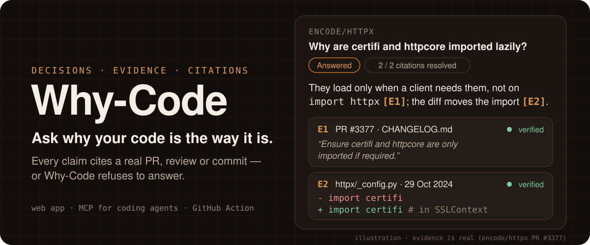
</p>

<p align="center">
  <a href="https://why-code-ten.vercel.app"><b>Open the live app</b></a> ·
  <a href="#quick-start"><b>Run it locally</b></a> ·
  <a href="docs/DECISION_LEDGER.md"><b>Decision ledger</b></a> ·
  <a href="https://why-code.onrender.com/health">API health</a>
</p>

<p align="center">
  
  
  
  
  
</p>

Code shows *what* it does. The reason it does it that way is somewhere else: in a PR thread from two
years ago, a review comment, or a commit message nobody remembers writing. Why-Code reads that
history, keeps the decisions it finds in a verified **decision ledger**, and answers questions like
*"Why are certifi and httpcore imported lazily?"* with citations to the real PR, diff and discussion.
If the record can't support an answer, Why-Code says so instead of guessing.

**No setup and no keys needed to try it:** open the [live app](https://why-code-ten.vercel.app), pick or
paste a public repository, and ask. All credentials (GitHub, Neo4j, the LLM) stay on the server.

<p align="center">
  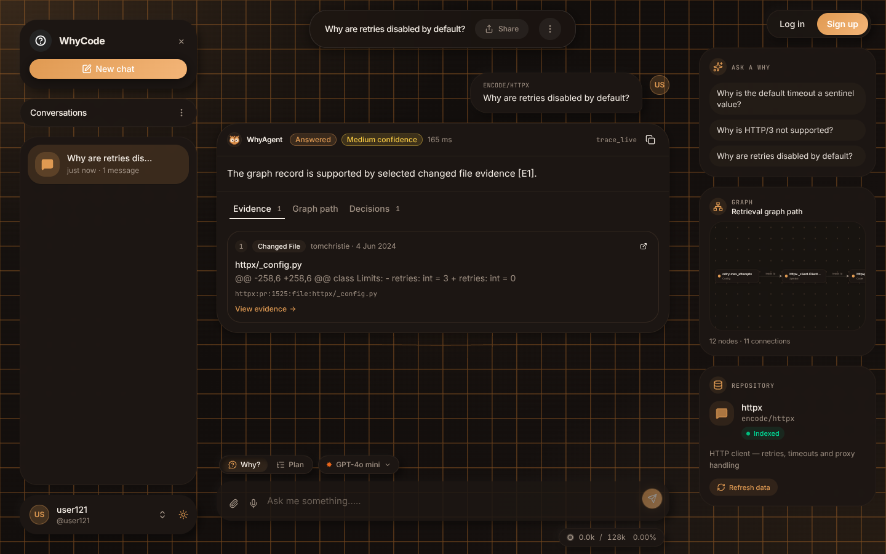
  <br/><sub>An answer with its status, confidence, evidence card and graph path. The data shown comes from the offline demo fixtures.</sub>
</p>

## What it does

- **Answers *why* questions with evidence.** Each sentence ends in a citation such as `[E1]` that
  links to a PR, review, commit or file. Citations that don't resolve are dropped, and an answer
  left with none is refused.
- **Keeps decisions as records, not chat replies.** The ledger stores who agreed to a decision, which
  files it governs, the exact supporting quotes, and whether it still matches the code.
- **Tells coding agents before they break something.** An MCP server lets Claude Code, Cursor or Codex
  call `get_why` before editing. A GitHub Action blocks a PR that changes a pinned decision unless it
  includes a `Decision-Ack:`.
- **Plans changes.** Plan mode lists what the codebase has already done (with proof) and what a change
  still needs.

## How it works

<p align="center">
  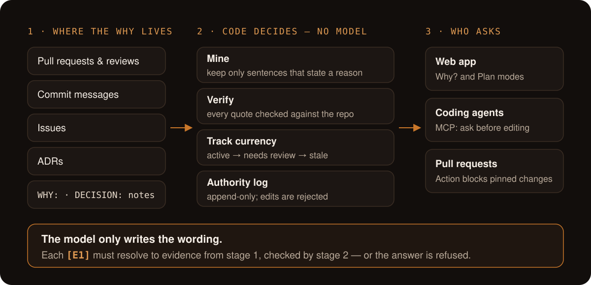
</p>

1. **Mine.** Deterministic miners read ADRs, `WHY:` / `DECISION:` / `TRADEOFF:` comments, commits that
   state both a choice and a reason, and (with `--pull-requests`) the descriptions, reviews and threads
   of merged PRs. They keep only sentences that give a reason. No LLM key is needed.
2. **Verify.** Every quote is checked against the checkout and labelled `verified`, `fuzzy` or
   `unverified`.
3. **Track currency.** Git history decides whether a decision is `active`, `needs_review` (half its
   files changed), `stale` or `superseded`.
4. **Govern.** An append-only authority log, enforced by database triggers, records who accepted each
   decision and why. Agents can propose decisions but can't put their own decisions in force.
5. **Answer.** Retrieval collects evidence, a language model writes the wording, and deterministic code
   checks every citation before the answer goes out. Confidence is computed, never taken from the model.

The model is a writer, not the authority. Remove it and the ledger, verification, currency checks,
authority log, PR check and MCP server all still work.

<details>
<summary><b>The full pipeline for deeply indexed repositories</b></summary>

```mermaid
flowchart LR
  GH["GitHub<br/>PRs · reviews · commits · issues"] --> ING["Ingestion<br/>normalize + score"]
  ING --> GRAPH["Graph builder<br/>files · symbols · regions · people"]
  GRAPH --> STRUCT["Structural enricher<br/>tree-sitter + config keys"]
  STRUCT --> DEC["Decision extractor<br/>LLM proposes · gates validate"]
  DEC --> NEO[("Neo4j<br/>evidence graph")]
  NEO --> RET["Retrieval<br/>exact + full-text + vector + graph expansion"]
  RET --> SYN["Synthesis<br/>constrained · citation-checked"]
  SYN --> API["FastAPI<br/>/api/v1"]
  API --> UI["Next.js UI<br/>ask · plan · decisions · share"]
```

**Two answer paths, one rule.** For any public repository, the hosted app fetches key files and
matching PRs and issues from GitHub. It adds the repository's ledger decisions when the ledger has
indexed it, and the model may cite only that fetched evidence. Fully ingested repositories (and the
demo) use the Neo4j pipeline above: hybrid retrieval (exact, full-text and vector search with graph
expansion), fused with WRRF, reranked and packed into the only evidence the model may cite.

</details>

## Benchmarks

All figures below come from runs recorded in this repository, with the conditions they were measured
under. They are small, hand-labelled sets, so read them as magnitudes, not leaderboard numbers.

### Decision mining: commits vs. PR discussion

<p align="center">
  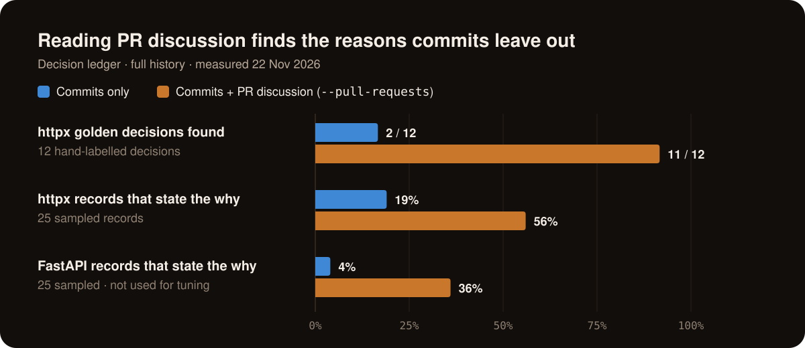
</p>

| Measured 22 Nov 2026, full history | Commits only | Commits + PR discussion |
| --- | ---: | ---: |
| httpx golden decisions found ([golden set](backend/app/intent/evaluation/golden/decisions.jsonl)) | 2 / 12 | **11 / 12** (10 with the right reason, 1 partial) |
| httpx non-decisions correctly left alone | 3 / 3 | 3 / 3 |
| httpx records that state the why (25 sampled) | 19% | **56%** |
| FastAPI records that state the why (25 sampled) | 4% | **36%** |
| httpx index time (1,270 PRs read) | 1.2 s | 31 s first run · 4.6 s cached |

The PR rules were written while looking at the httpx golden PRs, so httpx is not a clean holdout.
FastAPI was not used for tuning. The one golden miss (#3323) has no merge commit on the default branch.

### Indexing speed and quote verification

Commit mining only, shallow clones, `--commits 1000`:

| Repository | Files | Commits read | Decisions mined | Quotes verified | Time |
| --- | ---: | ---: | --- | ---: | ---: |
| encode/httpx | 125 | 1,000 | 18 from commits | 18 / 18 | 0.24 s |
| npryce/adr-tools | 92 | 159 | 9 ADRs + 2 from commits | 11 / 11 | 0.09 s |
| repowise-dev/repowise | 8,299 | 300 | 89 from commits | 89 / 89 | 1.7 s |

These are speed and verification figures, not precision. A hand review found roughly two in three
httpx commit decisions to be real design decisions. That's why commit-mined decisions start as
*background* and say so until someone accepts them.

### Answer layout: question-intent detection

<p align="center">
  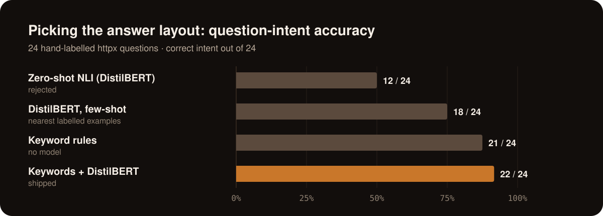
</p>

Why-Code detects what kind of question was asked (`rationale`, `history`, `ownership`, `location`…)
so a *why* answer reads as *In short → Why → Trade-offs → Where to look*. On 24 hand-labelled httpx
questions the shipped hybrid got 22 right. On 12 held-out questions written after tuning, the hybrid
got 10 / 12 and keywords alone got 9 / 12. A DistilBERT call takes about 35 ms on CPU. The intent only
shapes the layout: it never changes which evidence is fetched or whether an answer is refused.

## Comparison

### Why-Code vs. a chat assistant (ChatGPT, Claude)

Chat assistants are better general reasoners, and Why-Code uses a language model too. The difference
is that Why-Code is a system of record and a chat window isn't one.

| Job | Chat assistant | Why-Code |
| --- | --- | --- |
| Explain what code does | Excellent, often better | Not its focus. It explains *why*, from recorded evidence |
| Summarise the reason from PRs and commits | Can do it well with repo access | Same job, but saves the result as a decision |
| Durable, shared record for a team | Chats and memory are per person | One ledger that every person and agent reads |
| Prove a quoted reason exists | A model can't certify its own output | Code checks every quote: verified / fuzzy / unverified |
| Notice a decision has gone stale | No memory of what was agreed | Diffs governed files: active → needs review → stale |
| Show who approved a decision | No authority model | Append-only log; edits and deletions are rejected |
| Block a merge that breaks an agreed rule | Can advise in chat | A GitHub Action fails the check without a `Decision-Ack:` |
| Refuse instead of guessing | Sometimes, depending on the prompt | Enforced: no resolvable citation, no answer |
| Write or refactor code | Its core strength | Doesn't write code; it briefs the agents that do |

The best setup is both: let Claude Code or Cursor write the code, and connect Why-Code over MCP so
the agent checks `get_why` before editing and gets stopped at the PR if it breaks a pinned decision.

### Why-Code vs. what teams use today

| | `git blame` / `git log` | ADRs | Why-Code |
| --- | --- | --- | --- |
| Where the reason comes from | Commit messages only | Whatever someone wrote down | ADRs, code comments, commits, PR descriptions, reviews and threads |
| Needs someone to write it up | — | Yes, every time | No: mined from what already exists (ADRs included) |
| Quotes checked against the repo | — | No | Yes |
| Knows when a decision goes stale | No | No | Yes, from git history |
| Reaches coding agents and PRs | No | No | MCP server and a GitHub Action |

## Quick start

### Try it with no keys

The demo uses offline fixture data, with no Neo4j and no API keys:

```bash
./startdemo.sh          # macOS / Linux
.\startdemo.ps1         # Windows PowerShell (or double-click startdemo.bat)
```

The backend runs on `http://localhost:8000` and the frontend on `http://localhost:3000`.

### Index a repository's decisions

The ledger needs only Python, with no database server and no LLM:

```bash
cd backend && pip install -e '.[dev]'
python -m app.ledger index ../path/to/checkout --repo owner/name
python -m app.ledger index ../path/to/checkout --repo owner/name --pull-requests  # also read PR discussion (needs GH_TOKEN)
python -m app.ledger why httpx/_config.py
```

See [`docs/DECISION_LEDGER.md`](docs/DECISION_LEDGER.md) for the MCP server, the GitHub Action and the
`<!-- whycode:decisions -->` PR block.

### Run the full app

Prerequisites: Python 3.12+ and Node.js 20+. Production mode also needs Neo4j (AuraDB or local), an
OpenAI-compatible API key and a GitHub token.

```bash
git clone https://github.com/himanshuksr0007/Why-Code.git
cd Why-Code/backend
python3 -m venv .venv && source .venv/bin/activate
pip install -e '.[dev]'            # add '.[nlp]' for DistilBERT intent detection
cp .env.example .env               # fill in the values
set -a; source .env; set +a        # .env is not auto-loaded

PYTHONPATH=. uvicorn app.main:create_app --factory --reload        # live
PYTHONPATH=. uvicorn app.main:create_demo_app --factory --reload   # offline demo
```

```bash
cd frontend
npm install
cp .env.example .env.local         # defaults point at the local backend
npm run dev                        # http://localhost:3000
```

Or fill in `backend/.env` and run `./startprod.sh` (`startprod.bat` / `.\startprod.ps1` on Windows).

<details>
<summary><b>Run the ingestion pipeline</b></summary>

```bash
cd backend

# 1. Ingest merged PRs and normalize their history
PYTHONPATH=. python -m app.ingestion.cli ingest \
  --repo encode/httpx --since 2024-01-01 --limit 100 \
  --artifacts-dir ../artifacts

# 2. Enrich changed files with tree-sitter and load the graph
PYTHONPATH=. python -m app.structural.cli build \
  --repo encode/httpx \
  --normalized ../artifacts/normalized.jsonl \
  --high-signal ../artifacts/high_signal_prs.jsonl \
  --artifacts-dir ../artifacts --remote --write

# 3. Extract evidence-linked decisions (dry run; add --write to load Neo4j)
PYTHONPATH=. python -m app.intent.cli extract \
  --repo encode/httpx \
  --normalized ../artifacts/normalized.jsonl \
  --high-signal ../artifacts/high_signal_prs.jsonl \
  --structural-graph ../artifacts/structural/structural_graph.jsonl \
  --db ../artifacts/evidence.db \
  --artifacts-dir ../artifacts
```

Generated artifacts land in `artifacts/` and are git-ignored.

</details>

<details>
<summary><b>Run the tests</b></summary>

```bash
cd backend
PYTHONPATH=. python -m pytest        # 1,222 passed, 15 skipped (opt-in live Neo4j / LLM tests)
ruff check app/ledger tests/ledger
mypy app/ledger                      # the ledger package is mypy --strict clean

cd ../frontend
npm run build && npm run typecheck && npm run lint
```

</details>

## Features

<details>
<summary><b>Asking questions</b></summary>

- **Why? mode**: grounded answers built only from retrieved evidence, with deduplicated citations, a
  confidence rating, and refusals (`insufficient_evidence` and others) when the record can't support a claim.
- **Plan mode**: a Done / Needed step table, each row tied to evidence, plus a connection graph, built
  deterministically from the answer's own retrieval.
- **Structure questions**: a directory and module tree graph built from the real evidence paths.
- **Evidence everywhere**: every answer carries its evidence cards (diffs, PR and commit links), the
  decisions it relies on, and the graph path that connects them.

</details>

<details>
<summary><b>Models and composer</b></summary>

- The composer shows the server's active model and a live token meter based on provider-reported usage.
- **Bring your own model**: add any OpenAI-compatible model (name, model id, endpoint, API key). Keys
  are Fernet-encrypted at rest, scoped to your browser, and never shown again after saving.
- Attach text files (`Ctrl+U`), take a screenshot into the chat, or dictate with voice input.

</details>

<details>
<summary><b>Conversations, sharing and accounts</b></summary>

- Typo-tolerant chat search, rename, export to Markdown, and an **incognito mode** that never writes
  to storage or the URL.
- **Public links** for anyone, or **private links** limited to whitelisted @handles. Links update in
  place, and you can stop sharing at any time.
- Sign in with **Clerk** (Google / GitHub). The backend verifies the session token (RS256 against the
  instance JWKS, issuer pinned, expiry checked). Guests can do everything except share.

</details>

<details>
<summary><b>Repository tooling</b></summary>

- **Code changes feed**: each change shows its reasoning, its author, reviewers and participants, and a
  link to the commit. Direct commits are labelled as such, and nothing is synthesized to fill a gap.
- A **policy-as-code gate** (incidents need a postmortem, reversals need evidence), a **PR comment
  assistant** that drafts decision records, and a **golden-set regression runner**. See
  [`docs/FEATURES.md`](docs/FEATURES.md).
- **Candidate detection** for Python, Go, Java, Rust and TypeScript.

</details>

<details>
<summary><b>Screenshots</b></summary>

| Plan mode | Connection graph |
| :---: | :---: |
| 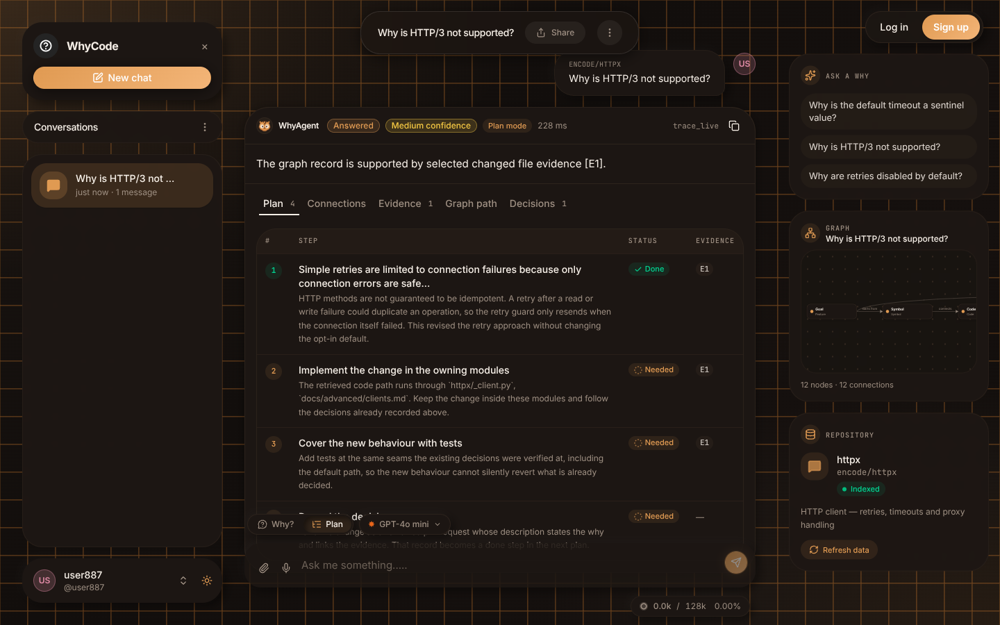 | 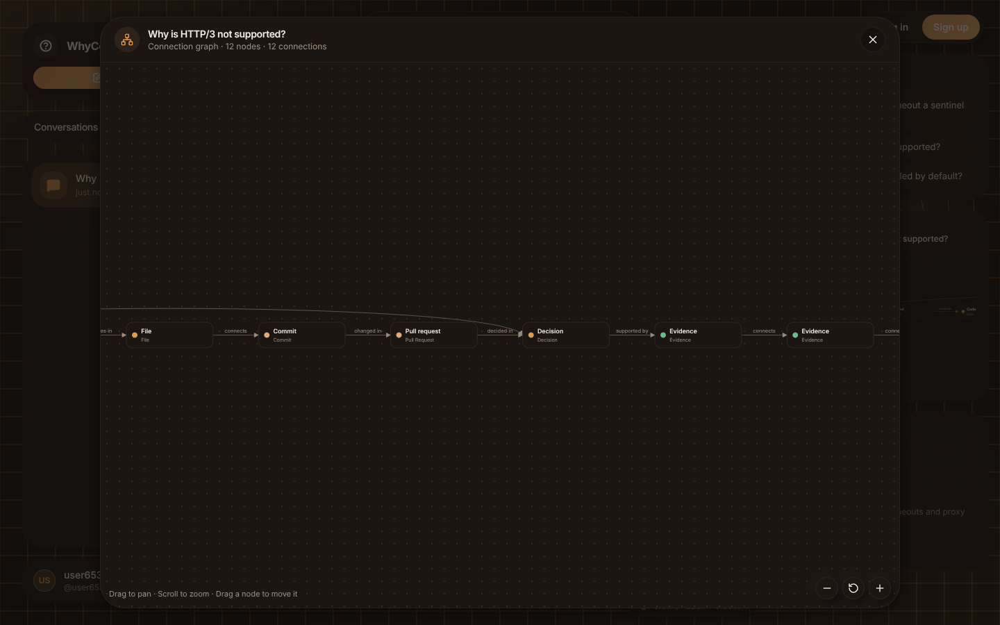 |

| Share a chat | Settings |
| :---: | :---: |
| 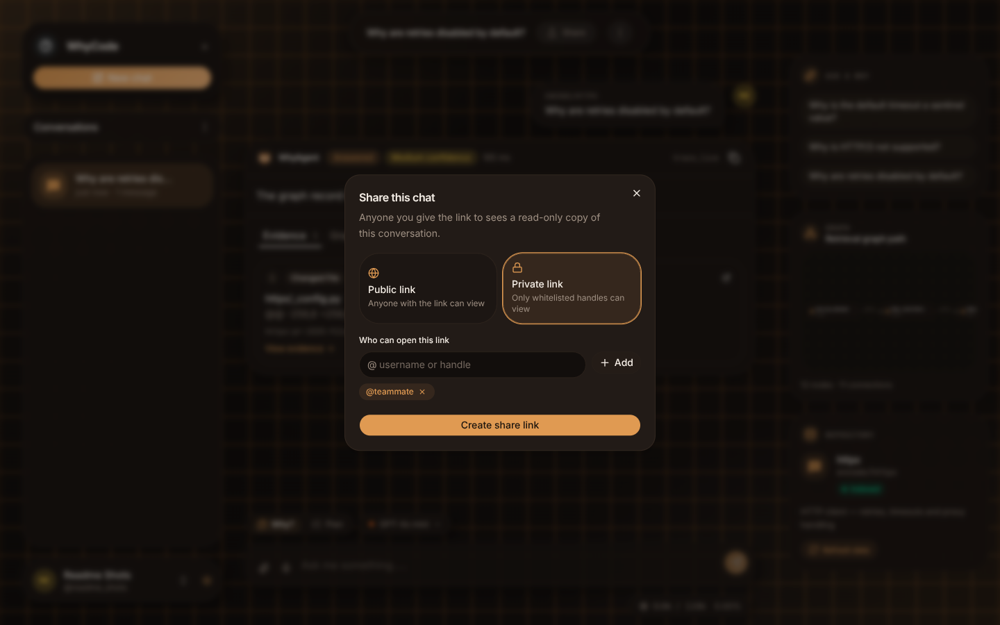 | 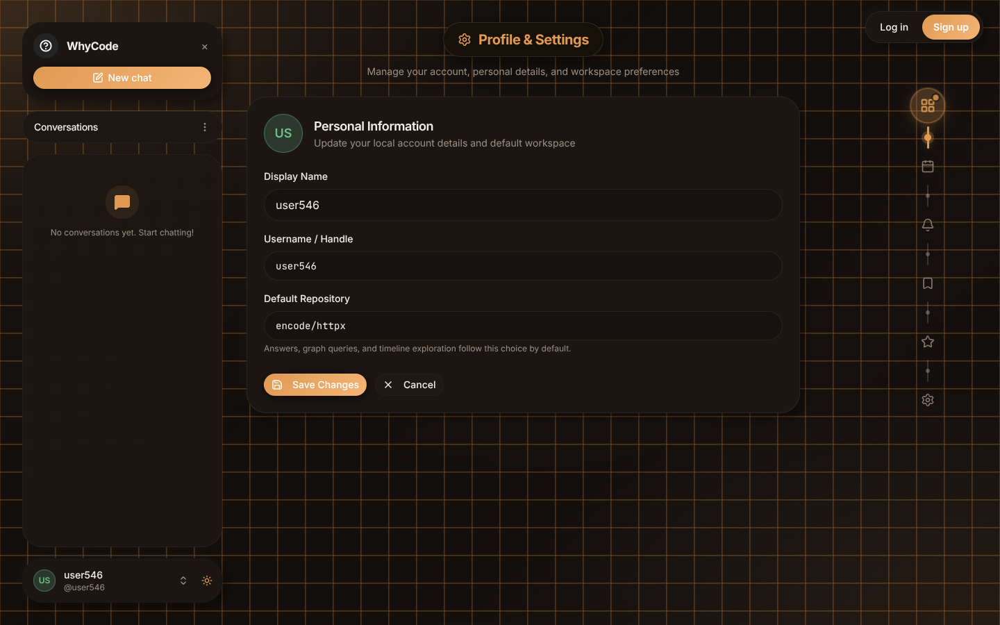 |

| Light theme | On a phone |
| :---: | :---: |
| 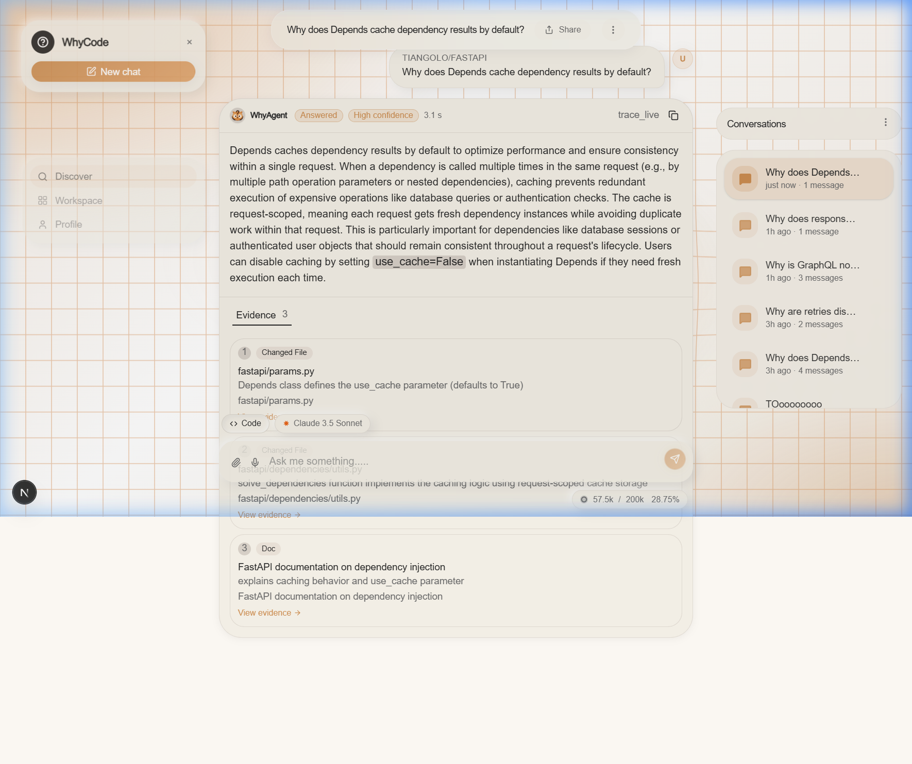 | 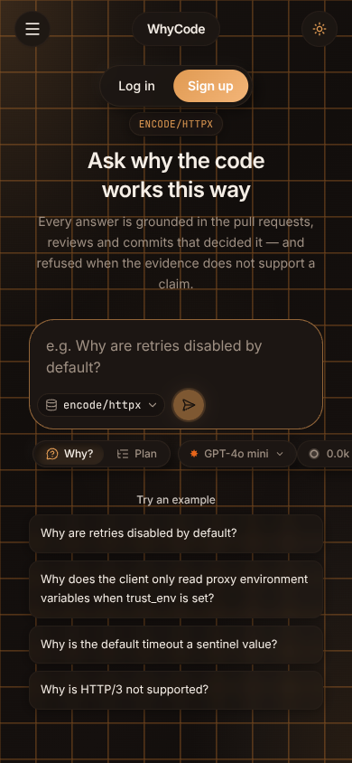 |

</details>

## Configuration

<details>
<summary><b>Backend (<code>backend/.env</code>)</b></summary>

| Variable | Required | Purpose |
| --- | :---: | --- |
| `WHYCODE_GITHUB_TOKEN` | ingestion | GitHub API token for repository ingestion and `--pull-requests` |
| `WHYCODE_NEO4J_URI` / `_USER` / `_PASSWORD` | production | Neo4j (AuraDB or local) connection |
| `WHYCODE_NEO4J_DATABASE` | — | Target database (default `neo4j`) |
| `WHYCODE_LLM_API_KEY` | production | OpenAI-compatible key (any compatible endpoint works) |
| `WHYCODE_LLM_MODEL` | — | Server model shown in the composer (default `gpt-4o-mini`) |
| `WHYCODE_LLM_BASE_URL` | — | Compatible endpoint (default `https://api.openai.com/v1`) |
| `WHYCODE_LLM_CONTEXT_TOKENS` | — | Context window used by the UI token meter |
| `WHYCODE_SECRET_KEY` | production | Fernet key encrypting visitors' custom-model API keys. Without it, saved keys are lost on restart |
| `WHYCODE_AUTH_SECRET` | production | Signs session tokens. Without it, sessions are lost on restart |
| `WHYCODE_GMAIL_ADDRESS` | auth mail | Sender address for verification emails (also the default Brevo sender) |
| `WHYCODE_BREVO_API_KEY` | recommended | Sends mail over Brevo's HTTPS API. Use it on hosts that block SMTP (e.g. Render) |
| `WHYCODE_GMAIL_APP_PASSWORD` | SMTP fallback | Gmail app password, used only when no Brevo key is set |
| `WHYCODE_MAIL_FROM` | — | Override the sender address |
| `WHYCODE_AUTH_DB` / `WHYCODE_SHARE_DB` | — | SQLite fallback paths for accounts and share links |
| `WHYCODE_WEBHOOK_SECRET` | webhooks | GitHub webhook secret; the receiver returns 503 until it is set |
| `WHYCODE_WEBHOOK_DB` | — | Webhook delivery store (default `artifacts/webhooks.db`) |
| `WHYCODE_ARTIFACTS_DIR` | — | Pipeline output directory (default `artifacts`) |
| `WHYCODE_LEDGER_DB` | — | Decision ledger SQLite path (default `artifacts/ledger.db`) |
| `WHYCODE_LEDGER_ADMIN_TOKEN` | ledger writes | Bearer token for ledger write routes; writes return 503 until it is set |
| `WHYCODE_NLP_ENABLED` | — | DistilBERT intent detection (default: on when `transformers` is installed) |
| `WHYCODE_DEFAULT_REPO` | — | Repository `/ask` uses when the request names none |

</details>

<details>
<summary><b>Frontend (<code>frontend/.env.local</code>)</b></summary>

| Variable | Purpose |
| --- | --- |
| `NEXT_PUBLIC_API_MODE` | `http` for the live backend (default), `mock` for offline fixtures |
| `NEXT_PUBLIC_API_BASE_URL` | Backend base URL when in `http` mode |
| `NEXT_PUBLIC_REPO` | Repository the UI asks about by default (e.g. `encode/httpx`) |

</details>

## Deployment

- **Frontend on Vercel**: root directory `frontend`, with `NEXT_PUBLIC_API_MODE=http` and
  `NEXT_PUBLIC_API_BASE_URL` pointing at the backend. Deploys on push to `main`.
- **Backend on Render**: runs the FastAPI app with the production env above, with its health check on
  `/health`. Render blocks outbound SMTP, so send mail through Brevo. Set `WHYCODE_SECRET_KEY` and
  `WHYCODE_AUTH_SECRET`, or keys and sessions reset on every redeploy.

Any equivalent split (a static or Node host plus a Python host) works the same way.

## Known limitations

- **Live answers are shallow for unindexed repositories.** The hosted app reads the first 70 lines of
  up to four ranked files, plus GitHub issue search. It refuses rather than guesses, but
  decision-grade answers need a repository indexed with the ledger or the full pipeline.
- **Commit mining is heuristic.** About two in three commit-mined httpx decisions are real design
  decisions, so they start as *background* and are labelled that way.
- **The benchmarks are small.** The golden set has 15 httpx cases. A larger labelled precision/recall
  benchmark is the next thing to build.
- **Coverage is narrow.** Structural parsing is Python-only and ingestion is GitHub-only. The ledger
  itself works on any language.
- **Answers read text only.** Attached images render in the chat, but the model reads only inlined
  text files.

## Documentation

| Topic | Document |
| --- | --- |
| Decision ledger, MCP and GitHub Action | [`docs/DECISION_LEDGER.md`](docs/DECISION_LEDGER.md) |
| Backend guide | [`backend/README.md`](backend/README.md) |
| Decision platform features | [`docs/FEATURES.md`](docs/FEATURES.md) |
| Ingestion · Graph · Structural · Intent · Retrieval | [`ingestion`](backend/app/ingestion/README.md) · [`graph`](backend/app/graph/README.md) · [`structural`](backend/app/structural/README.md) · [`intent`](backend/app/intent/README.md) · [`retrieval`](backend/app/retrieval/README.md) |
| Product decisions | [`docs/DECISIONS.md`](docs/DECISIONS.md) |
| Golden decision set | [`docs/GOLDEN_SET.md`](docs/GOLDEN_SET.md) |

<details>
<summary><b>Project layout</b></summary>

```text
.
├── backend/
│   ├── app/
│   │   ├── ledger/        # decision ledger: miners, PR mining, verification, currency, MCP, PR check
│   │   ├── retrieval/     # hybrid retrieval, answer prompt, synthesis, plan + structure builders
│   │   ├── nlp/           # question-intent detection (keywords + DistilBERT)
│   │   ├── ingestion/     # GitHub ingestion → normalized history
│   │   ├── graph/         # Neo4j graph builder
│   │   ├── structural/    # tree-sitter enrichment
│   │   ├── intent/        # decision extraction (LLM + gates) and golden-set evaluation
│   │   ├── auth/ shares/ models/ features/ core/ domain/
│   │   └── main.py        # FastAPI factories (live + demo)
│   ├── tools/             # policy gate, PR decision assistant, golden runner
│   └── tests/
├── frontend/              # Next.js 16 app
├── site/                  # public website
├── docs/
├── assets/readme/         # README images
└── action.yml             # the decisions GitHub Action
```

</details>

---

<p align="center">
  <sub>FastAPI · Pydantic · tree-sitter · Neo4j · Next.js 16 · Tailwind CSS v4</sub>
</p>
